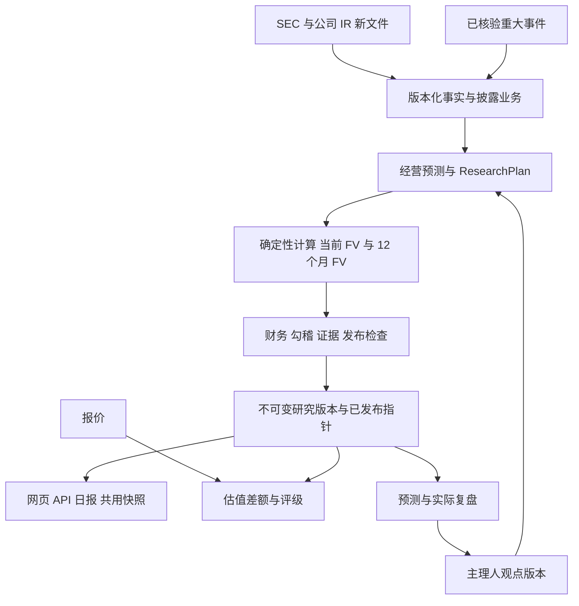

# Signal Ledger AI 估值引擎：顶层设计与 medium 执行规格

设计日期：2026-09-21（纽约时间）。审阅对象：`https://signalledgerlab.com/`、线上 `/fair-value` 页面，以及本地 `market-signal-lab` 工作区，HEAD `cdda372` 加现有未提交修改。

本文是实施规格，不是实施完成报告。本次只读审查代码和网页，新增此设计文件；没有改动估值实现、调用 AI 重估、部署或写入生产数据库。已有审计报告的测试结果没有在本次重新执行；本地代码状态也不等于生产部署状态。

## 1. 要交付的产品

将现有引擎升级为持续运行的公司研究系统：**最新公开证据 → 财务与业务拆分 → 经营预测 → 当前 FV 与 12 个月条件 FV → 质量检查 → 全站同一版本发布 → 事件重估与预测复盘**。

保留两个可比较的研究视角：

- **Independent Baseline**：相同事实与明确的默认研究政策下，独立形成的经营预测。
- **Signal Ledger View**：在相同事实基础上，叠加主理人批准的公司/行业判断，再由同一套数学计算 FV。

“观点契合”的目标是让系统准确表达主理人对业务、产业周期和风险的判断。不能将“FV 接近主理人想要的价格”作为训练目标。即使双方一致看好 AI，合理输出也可能是“好公司，但现价已经包含过高预期”。

第一轮建议以 **NVDA + ORCL** 打通半导体和云两种业务，**AMD** 做已有页面的回归验证；随后扩展 MSFT、AMZN、GOOGL、AVGO、MU，再处理 TSM 的 IFRS、外币与 ADR 口径。这个顺序是开发覆盖顺序，不是投资排序。

## 2. 已有能力与真正缺口

以下位置均相对于本仓库；行号对应本次审阅状态，执行时按符号再次定位。

| 观察 | 当前证据 | 对实施的要求 |
|---|---|---|
| 已有 SEC 财务读取、模型路由、确定性估值和研究计划编译器 | `lib/valuation-data.ts`、`lib/universal-valuation.ts`、`lib/research-*.ts` | 复用现有模块，先补通路与语义，不另建第二套引擎 |
| 新研究循环代码存在，但网页运行接口仍调用旧路径 | `lib/valuation-ai.ts:770`；`app/api/valuation/run/route.ts:2,47` | 在正确性验收后接入后台研究作业，不能只替换函数名就上线 |
| 默认页面快照使用确定性旧 profile；GET 估值接口还单独计算 | `lib/investment-snapshot.ts:351`；`app/api/valuation/[ticker]/route.ts:42` | 网页、API、首页、监控统一读取同一已发布 run |
| 财报正文入口只选 10-Q，且默认正文读取有 ticker 白名单 | `lib/valuation-data.ts:124,1671` | 覆盖年度、季度、修订、财报新闻稿/附件；将“最新完整报表”和“最新补充信息”分开 |
| AMD/ORCL 业务解析已有，但主要是专属正则、单季年化和固定参数 | `lib/valuation-data.ts:1353–1429` | 保留适配器，增加期间、维度、来源定位、勾稽及连续预测 |
| 管理层指引尚未形成正式输入版本 | `lib/valuation-data.ts:2056–2064` 的 `guidanceVersion: unconnected` | 指引单独版本化，按期间与指标约束预测 |
| 多业务研究计划会自动走 SOTP，当前段价值主要取第一年指标乘倍数 | `lib/research-compiler.ts:175–235,303–359` | 真正实现所声明的分部估值方法；未支持方法必须返回能力缺口 |
| ResearchCheck 失败未成为统一发布阻断；资本/融资字段消费不完整 | `lib/valuation-ai.ts:922–969`；`lib/research-compiler.ts:238–245,295` | 加统一发布闸门、字段到公式消费表和经济含义测试 |
| 研究引用 ID 可由计划自行声明；合法倍数修订还可能被 0–1 范围误拒绝 | `lib/valuation-ai.ts:583,590–605` | 证据注册表由抓取器创建；概率、利率和倍数分别做单位/范围校验 |
| 文案可能沿用旧研究，而数值已采用新模型 | `lib/valuation-data.ts:1966,1998–2018` | 解释文字必须绑定同一 run 与输入版本 |
| 新闻监控与估值重算尚未连成闭环 | `monitor-worker/src/index.ts:3261–3296,3982–4013` | 在已去重的事件处理后写入可重试估值任务 |
| 财务包 12 小时缓存 key 缺少证据版本；快照 15 分钟 | `lib/valuation-data.ts:72,2078`；`lib/investment-snapshot.ts:110` | 事件驱动版本失效，不能只等 TTL |
| 盘后历史通过匿名批量接口取得 teaser，缺少完整模型证据 | Worker `src/index.ts:7957`；`app/api/valuation/snapshot/route.ts:55` | 用服务间认证读取完整版本，保留公众会员限制 |
| UI 只有增长、利润率、倍数三个即时调整，未形成持续的主理人观点库 | `app/fair-value/workstation.tsx:154–156,912–915`；`lib/daily-brief.ts:770` | 将即时情景与正式研究观点分开，增加可版本化观点 |

线上直接观察也支持“版本一致性”应优先修复：AMD 页面当时显示约 $204 的站内 FV，主假设为 equity cash flow $14.4B → $28.4B，下方却仍写 FCFF $16B → $63B；同时存在“质量门槛通过”与“仅供初筛”的不同表述。这些只是页面展示的审计证据，不代表本次认可其报价或公允价值。搜索工具取得的旧页面与实时浏览器内容不同，因此以实时页面观察为准。

## 3. 总体架构与边界

复用现有 React/vinext、Worker、D1 和研究模块。任务调度首先复用已有 cron、去重和锁机制，以 D1 outbox/任务记录接通；无需首轮引入向量库、大型工作流平台或模型微调。大原文若超出当前存储适用范围，再加入内容寻址的对象存储；D1 保存索引、事实和版本，不反复存取整份大文件。

AI 负责理解文件、识别业务、提出带证据的参数与修改建议。确定性代码负责全部财务计算、情景聚合、资本桥接、每股价值、变化归因和发布判定。外部文档只能作为数据，不能给执行器下指令。

报价不参与经营预测的“迎合目标价”循环。必要的市场资本成本输入由独立模块、按固定日期和规则提供；前端报价刷新不立即重设 WACC。Reverse DCF 单独解释市场隐含预期，不反过来自动改变独立研究假设。

当前旧 reviewer 输入仍包含 model.value 和 marketPrice（`valuation-ai.ts:394–402`）。P0 应让所有参与公开发布的 planner/reviewer 使用统一价格隔离输入，不只靠提示词。测试截获实际发出的 payload，验证其中没有当前股价、已计算 FV 和目标价；正式公开输出之后可以另做市场比较。

## 4. 财报与业务数据：先做可信的事实层

### 4.1 来源与抓取

1. 使用 SEC submissions 检测 accession 和 accepted/published 时间；公司 IR 官方 earnings release、presentation、官方电话会资料作为补充，8-K/6-K 附件作为财报发布的早期入口。
2. 分开追踪 `latestAnnualReport`、`latestQuarterlyReport`、`latestEarningsRelease`、`latestGuidance` 与 amendments。新的 8-K 不能整包覆盖 10-Q 财务历史，更新的 10-K 也不能被旧 10-Q 遮住。
3. Companyfacts 用于公司整体财务基础；分部与细分业务读取原始 iXBRL dimensions、自定义标签、财报附注与表格，保留文档结构。不能只取正文前若干字符便视为完整业务证据。
4. 收入、营业利润、现金流、CapEx、债务、现金、股本首先走结构化解析；AI 处理表格映射与叙述披露，并返回原文定位。无法定位的数字不能进入 reported 层。
5. 财报新闻稿、正式申报、后续修订保留关联与差异。按指标、期间、会计口径解决冲突；重大不一致阻止候选发布，不将较新发布时间一律等同于更可靠事实。

SEC 官方说明 Companyfacts 聚合的是非自定义 taxonomy、适用于整个主体的事实，因此它无法单独解决业务分部问题；官方也明确 API 随申报更新。参见 [EDGAR API 文档](https://www.sec.gov/search-filings/edgar-application-programming-interfaces)。

### 4.2 最小证据合同

在现有类型上扩展，不要求每个逻辑实体新建一张表：

| 对象 | 必要字段与规则 |
|---|---|
| SourceDocument | issuer/CIK、form、accession、URL、publishedAt、retrievedAt、contentHash、amends/supersedes、解析版本 |
| FinancialFact | metric、value、unit、currency、periodStart/End、instant/duration、fiscalPeriod、GAAP/non-GAAP、dimensions、sourceId、表格/行/标签定位、提取方式 |
| EvidenceLabel | reported / management_guidance / licensed_consensus / model_estimate / owner_thesis；事实、指引与估计不能混标 |
| BusinessNode | 披露业务 ID、分析业务 ID、父子关系、有效期间、分摊规则、排重关系、收入/利润/资本与证据 |
| Assumption | 指标、期间、基准值、情景值、来源/推导、约束、理由、失效条件、所属观点版本 |

同时保存 `publishedAt` 和 `retrievedAt`，历史复盘只能使用当时已公开并已可获得的版本，避免未来信息泄漏。重述和业务重分组保留旧口径，再建立可比较映射。

EvidenceRegistry 必须由抓取与解析层生成。AI 只能引用其中真实存在、与当前公司/期间/指标相关的 evidenceId；不能在自己的 sources 数组编一个 ID，再用这个 ID 证明自己的数字。结构化 schema 通过不等于事实核验通过，关键金额要确定性复核到原始单元格/标签。

### 4.3 必须通过的财务核对

- 单季、累计 YTD、年度、TTM 分开。Q4 = FY − 9M 的派生必须有同版本期间来源；现金流累计项不能直接当单季，单季×4只能作为明确标识的临时估计。
- 各分部对外收入 + 合并调整 = 合并收入；内部交易抵销不能再算销售。建议容差按披露舍入精度和合并收入相对容差共同定义，而非固定忽略数十亿美元。
- 业务利润加总部费用、抵销和其他调整后对齐公司利润。分部未披露 CapEx/利润率时标为模型分摊，不能标成官方数字。
- 股份单位、拆股、加权平均稀释股数、期末股数、ADR 比率分开；EPS 使用其对应期间股数，每股估值使用估值日/远期完全稀释股数的明确桥接。
- 53 周财年、不同财年截止日、币种、并购和重分类有显式处理；不可比时降低可用性，不能强行比较。

## 5. 面向 AI 半导体与云的预测模型

下表是要配置的分析层级，最终必须服从最新披露；并不宣称每项细分均有公司公布的金额。

| 公司类别 | 业务分析层 | 关键经营变量 | 估值重点 |
|---|---|---|---|
| NVDA/AMD | 披露业务为根；数据中心内的加速器、CPU、网络等，仅在有披露或透明估计时再拆 | 数量/ASP、供给、客户 CapEx、份额、产品切换、毛利、研发、营运资本 | 业务预测汇总后的 DCF；SOTP 仅在业务差异与证据支持时使用；远期盈利作交叉检查 |
| AVGO | 半导体与软件；AI ASIC/网络作为子驱动 | 客户项目、投产概率、出货量、软件续约、利润率 | 有分部证据的 SOTP，正确分摊总部费用和净债务 |
| MU | 披露分部及产品视角；HBM 与其他 DRAM/NAND 只能形成互斥或明确嵌套分析 | bit growth、ASP、产能/良率、HBM 份额、周期价格、CapEx | 结构性增长与存储周期分开，估值跨完整周期 |
| ORCL | 披露云与软件业务为根；OCI/应用等按官方披露映射 | 已签订单、RPO 转收入节奏、容量、电力、利用率、CapEx、融资 | 云增长与旧业务分开预测，重点检验现金转换及资本需求 |
| MSFT/AMZN/GOOGL | 最新官方报告分部为根；Azure/AWS/Google Cloud、AI 产品作为有来源的子分析 | 算力容量、单位收入、利用率、客户消耗、折旧、租赁、AI 产品付费率 | 云与非云业务分别建模，不能让 AI 增长假设覆盖全公司所有业务 |

每个核心业务至少输出未来 **8 个季度** 的经营路径，再衔接 **5–10 年** 的年度现金流；远期年限按业务成熟速度设定，不要求所有公司相同。收入、毛利、费用、税、D&A、CapEx、营运资本和股份路径须能对账。

数据充分时使用 `数量 × ASP`、`可用容量 × 利用率 × 单位收入` 等驱动；数据不足时使用带范围的增长/利润率假设并标注依据，不能为了公式完整创造 GPU 数量或 Azure 绝对收入。

AI CapEx 增长不自动等于云厂商 FV 上涨：必须同时增加建设支出、折旧、供给能力，并检验可变现需求。客户支出、芯片收入、云收入之间保存关联约束，不能在同一家公司多层业务重复计入同一收入或同一 AI 期权。

## 6. 当前 FV 与 12 个月展望的严格定义

### 6.1 两个必需输出，一个后续可选输出

- `fairValueNow`：按估值日价值计量、折现到今天的每股内在价值；它已经包含未来业务现金流。
- `fairValue12m`：在今天选定的经营与资本情景下，站在 12 个月后重新计量的条件每股内在价值；显示 targetDate 和情景区间。
- `priceOutlook12m`：市场可能给出的交易价格区间。首轮不强行提供，除非另有可验证的估值收敛/倍数与市场模型。不得把 FV 区间改名为股价预测。

当前 FV 与 12m FV 都提供 Baseline / Signal Ledger View，以及 Bear/Base/Bull。情景是不同经营路径；P10/P50/P90 是输入分布下的敏感性结果，未经校准不能宣称真实发生概率，也不与经营情景直接混用。

### 6.2 计算要求

FCFF 路径：

`FCFF = EBIT × (1 − tax) + D&A − CapEx − ΔNWC`

`EV(t) = PV_t(未来经营 FCFF 与终值)`

`EquityValue(t) = EV(t) + ExcessCash(t) + OtherNonOperatingAssets(t) − Debt(t) − PreferredClaims(t) − NCI(t) − OtherClaims(t)`

上述各项必须互斥，现金不能又被包含在其他非经营资产中；经营所需现金也不能无条件全额额外加回。公司未披露/确无某项索取权时，明确其缺失与零值的区别。

`FV(t) = EquityValue(t) / 对应估值日完全稀释股数(t)`

12m 结果使用 **12 个月以后的剩余现金流**、届时预计现金/债务/其他索取权与股份；期间经营现金流、投资、利息、分红、回购和融资全部进入同一个资本滚动表。要支持季度/日期折现与财年错位，不能把财年末简单当作一年后。

FCFF 用 WACC。真正的 FCFE 用股权成本且不再减同一笔债务；`CFO − CapEx` 只是可能含利息等影响的现金流代理，并不自动等于完整 FCFE，必须说明净融资、非经营收益等调整及限制。

不能把 FV-now 乘“预计营收增长率”作为 12m FV。常数 WACC、期末现金流、无新增信息的简化企业价值案例可验证 `EV1 = EV0 × (1 + WACC) − FCFF1`，但不能把该校验式替代真实的资本滚动。若展示 `(FV12m + 期间每股股息 − 当前价格) / 当前价格`，应标为“假设价格收敛至 FV 的回报”，不是无条件预期回报。现金流与折现率匹配原则参见 [NYU Stern 估值框架](https://pages.stern.nyu.edu/~adamodar/New_Home_Page/background/valintro.htm)。

### 6.3 模型使用与校验

- 主模型事先按业务证据选定；其他方法作为交叉检查，不强制把相关性很高的几个倍数模型平均来营造“多模型确认”。
- SOTP 的每个分部调用真实方法：DCF 分部必须消费完整现金流、折现率和终值；倍数分部明确 metricPeriod、valuationDate、EV/股权口径，再桥接到同一日期。
- 当前代码的“后续年份不影响某些分部价值”“多业务必然 SOTP”“缺倍数默认 1”必须修复；支持不了的组合返回明确能力缺口。
- 资本、债务融资、利息、稀释、股份回购、租赁、SBC 都要列出“进入哪个公式、何时进入、是否已计入”。不能用数组长度一致来证明经济影响已计算。
- SBC 选择一致的经济成本与股数处理政策；不能无条件把历史 SBC 加回，同时既不扣经济成本又忽略稀释。租赁是否资本化、研发是否调整，必须成套调整现金流、利润与资本桥。
- 完整 Bear/Base/Bull 情景覆盖同一批业务是正常现象；互斥是“世界状态互斥”，不是要求三个情景业务 ID 不重叠。穷尽情景概率合计为 1；同一风险只计权一次。
- 合法倍数修订（如 20× → 24×）不得被概率的 0–1 规则拒绝；利率、倍数、金额和股份各有单位校验。不得用过低的通用增长上限静默截断高增长业务，超出历史范围应要求解释和压力测试。

## 7. 多轮观点校准：形成可复盘的研究政策

首轮不微调模型。复用 ResearchPolicy、ResearchPlan 与白名单 patches，增加一个只对主理人开放、可版本化的观点工作区。

Baseline 只能使用原始证据与独立政策，不能通过 legacyPrior 继承已经叠加主理人判断的 curated baseline。当前 `research-firewall.ts` 中的 legacyPrior 要审计来源并明确隔离。仅改变 thesisVersion 时，独立 Baseline 的计划与数值必须保持不变，Signal Ledger View 才改变。

观点分三层：

1. **长期研究偏好**：优先研究 AI 半导体和云，重视份额、供需和资本回报等方法偏好。它决定关注什么，不直接给公司加估值溢价。
2. **行业假设**：例如 AI 建设周期持续期、推理需求增速、供给瓶颈；有适用公司、时间范围、支持证据和反证。
3. **公司假设**：具体业务、季度或年份的增长、份额、利润率、投资、商业化概率等。

建议的单条观点合同：`scope + metric + period + baselineValue + proposedValue/range + rationale + evidenceRefs + confidence + expiresAt + falsificationRule + approvedVersion`。用户只表达方向时，系统给出待讨论范围，不能静默编造精确数值。

一次磨合的产品流程：

`主理人描述判断 → AI 找出与 Baseline 的具体分歧 → 展示经营假设差异及 FV 敏感性 → 主理人保存该观点 → 生成新的 Signal Ledger View → 下次财报核验`

例如“我认为 OCI 的订单会更快变现”：应讨论订单转收入进度、交付容量、CapEx、利润率和回款，而不是笼统提高 ORCL 倍数。反证条件必须可观察；新财报触发条件时，自动把该观点标为受挑战/失效，按预先批准规则更新或退回基准，并留下原因。

保留 Baseline 与主理人版本的并排差异和变化归因，不能用主理人观点覆盖 reported 事实。允许 AI 明确保留不同判断，并指出哪条后续披露能解决分歧。普通订阅用户的临时模拟不能写入主理人政策或全站发布版本。

复盘评价分开：收入、利润、现金流、份额/转化率的预测误差；经营情景概率校准；实际投资回报与简单基准。未来交易价格不是不可观测内在价值的唯一真值，不能把“更贴近股价”直接训练为更正确的 FV。样本不足时保留透明先验，不声称已学习出可靠模型权重。

## 8. 重大事件如何及时改变 FV

### 8.1 调度目标

复用现有每分钟 Worker 调度，按覆盖名单和 `next_due_at` 查询到期任务。建议初始目标：重点公司的 SEC/IR 平时每 15 分钟检查，已知财报窗口每 2–5 分钟检查，夜间补漏核对；具体频率以来源限制和成本实测调整。

设计 SLO：在来源正常、官方事实可以解析、所需数据齐备时，从官方发布时间到新版本可见，重点财报争取 30 分钟内完成。记录 `sourcePublishedAt → detectedAt → parsedAt → valuedAt → publishedAt`，分开统计供应商延迟和系统延迟。这是待压测的目标，不是当前已达到的能力或不附条件的实时承诺。

请求通过共享限速器、可识别 User-Agent、重试退避与缓存控制；建议内部并发限速明显低于 SEC 总计每秒 10 次上限。多个作业共享额度，不能每个 Worker 单独按上限请求。见 [SEC Developer Resources](https://www.sec.gov/about/developer-resources)。

### 8.2 从事件到经营参数

| 事件 | 修改对象 | 处理 |
|---|---|---|
| 新财报/正式指引 | 报告事实、下一季/年度预测、利润率/现金流 | 生成新证据版本，完整重估 |
| 正式合同、产能投产、产品延期 | 相关业务收入时点、概率、容量、成本 | 有定量证据或已有批准映射规则才自动更新 |
| 出口限制、重大客户削减采购、监管决定 | 可服务市场、地区收入、订单、投入或经营概率 | 使用已核验文件及预设情景，保留影响期限 |
| 有影响但无法量化的信息 | 研究待核验事件、潜在受影响变量 | 显示正在评估，不编造百分比调整 FV |
| 媒体转述、重复报道、市场情绪或单纯股价上涨 | 无新的基本面事实 | 去重或更新市场层，不机械改变经营价值 |

标准 `EventImpactProposal` 保存：eventId、sourceId、受影响业务、参数路径、旧值/新值或区间、生效期间、理由、可信度、重复事件归属和相关公司。一次消息对多家公司要分别解释影响；供应链关联不是给所有 AI 股票同样加价的理由。

先核验事件是否已经包含在现有指引或研究假设中。同一公告的 IR、SEC 附件和媒体转述关联到一个经济事件；新增消息只计算尚未计入的变化，避免同一订单在多个阶段重复提高预测。

所有新硬事实都进入事实层并可触发确定性重算，微小影响可以合并发布。建议初始通知阈值为绝对 FV 变化达到 5% 或观点证伪；该阈值只是可配置的通知政策，不是“不足 5% 就不更新事实”的门槛。正负事件使用相同标准，累计小变化也要考虑。

### 8.3 可重试且不能覆盖旧好版本

- job 去重键使用 issuer + evidenceHash + thesisVersion + engineVersion + policyHash + valuationDate/horizon；市场报价独立版本。
- 状态：queued → running → validated → published；也可转 failed/quarantined。作业有租约、超时、重试次数和错误分类。
- 同一 accession/contentHash 重复到达只产生一份有效证据；迟到的旧作业不得覆盖较新发布版本。
- 每次运行保存输入快照、计划、模型代码/配置版本、随机种子、结果、检查、父版本和 AI/工具实际调用记录。AI 不要求重采样结果完全一致；回放使用当时保存的计划和工具证据。
- 发布时原子更新 published pointer。缓存只加速读取，不能作为唯一历史存储。新候选不通过则保留最近合格版本，显示原日期与待更新状态；已经失去参考意义的旧版本改为历史参考，不伪装成当前可决策 FV。
- 每次 FV 变化输出“事实/经营预测/主理人观点/资本成本/股数/时间滚动/模型修复”的贡献桥。用固定顺序重算并披露交互残差，或采用可复现的归因法，贡献合计必须与总变化对齐。

## 9. 统一发布、数据版本与页面

### 9.1 单一发布合同

在现有 InvestmentSnapshot 上扩展以下内容：

`publishedRunId, parentRunId, valuationDate, targetDate12m, sourceAsOf, priceAsOf, publishedAt, evidenceHash, thesisVersion, engineVersion, policyHash, releaseStatus, fairValueNow, fairValue12m, scenarios, businessBreakdown, changeAttribution, nextCatalysts`

内部保留完整研究输入与证据，公众仍按当前 Free/Pro 规则投影。内部监控通过受限服务身份取得完整已发布快照；不得通过取消会员判断修复监控问题。

网页、公开 GET API、首页、财报页、期权页和日报都读 publishedRunId 指向的同一结果。报价刷新可以更新价格差额/评级，但不生成新的基本面研究版本。研究 Run 请求进入后台任务并返回状态；私人 what-if 与公开发布隔离。

沿用已有 `issuer_profiles`、`research_plans` 和 Worker 事件/历史记录；评估后最少增加或扩展：来源/事实存储、观点版本、估值作业、不可变 run 与发布指针。必须明确 app DB 与 monitor DB 的 schema 所有权，不可把一方初始化器用于另一方数据库。

### 9.2 发布闸门

1. **证据门**：实体、期间、单位、来源定位、收入勾稽和关键资本数据完整；解析冲突、未来信息、虚构 reported 数据属于阻断项。
2. **模型门**：所声明的方法真实执行；关键字段实际进入公式；所有业务覆盖且无双算；情景、现金流和股权桥成立。
3. **研究门**：重要增长/利润率/资本开支假设有合理证据或明确的估计/观点依据；reviewer 失败、超时或 schema 错误不得报告“已审阅通过”。
4. **表达门**：数字、文字、来源、时间、版本和评级一致；禁止旧文案混入新模型。

状态统一使用 released / screening_only / withheld，并明确 freshness。硬错误不能靠平均置信度抵消。规则决定是否允许自动发布：强证据且全部通过自动发布，证据冲突或缺关键输入的候选进入隔离；无需为每次正常财报更新人工点击批准。

特别处理 `runResearchValuation` 缓存命中/回退分支：分别记录 `aiCalledThisRun`、`planOrigin`、`reviewStatus`。缓存命中的已审核 AI 计划本次可以调用 0 次 AI，但保留原计划的 AI 来源和审核记录；deterministic fallback 不能冒充 AI-reviewed。旧 `AI_used` 字段要明确并统一其语义。失败计划只能作为 draft/failed 留档，不能覆盖 approved profile 或成为下次正常研究的权威缓存。

### 9.3 页面展示顺序

保留现有海军蓝、象牙白和克制的橙色、阅读型研究布局，不做全站重设计。

1. 公司、行情日期、当前 FV、12m 条件 FV、两者相对现价的差额、研究可用状态。
2. 一段明确结论：价值由哪两三个业务推动、相对上版为什么改变。
3. 业务表：最新收入与利润、未来收入/利润、估值方法、价值贡献、事实/估计标签。
4. Baseline 与 Signal Ledger View 差异：哪些经营假设不同，各影响多少。
5. 未来 12 个月催化剂与可证伪条件；条件情景区间与输入敏感性分开标识。
6. 版本历史与 FV 变化桥；原始证据、公式和质量检查放在可展开详情。

公开页不出现主理人配置、基础设施信息或秘密；只显示读者需要理解估值的假设。来源新鲜度和模型可用状态优先于看似精确的综合置信度百分比。

## 10. medium 执行顺序与完成标准

先读取当前工作区和本文件，不清理/覆盖已有未提交修改；旧审计报告仅供定位，不当成最新成功证明。不要一开始改配色、扩大股票池或调高 FV。

| 阶段 | 工作与主要落点 | 必须交付的验收 |
|---|---|---|
| P0 正确性与发布合同 | `research-compiler.ts`、`research-check.ts`、`valuation-ai.ts`、`investment-snapshot.ts`；修正模型消费、检查阻断、AI 身份、旧文案、版本/状态与旧 reviewer 价格输入 | 多期 segment DCF 真正使用后续年份；资本/融资/稀释方向性正确；失败候选不发布；实际 AI payload 通过价格隔离检查；同一 run 的数值与文案一致 |
| P1 自动证据与业务拆分 | `valuation-data.ts`、`research-tools.ts`、Worker 文件发现；NVDA/ORCL 正式适配器，AMD 回归 | 最新年度/季度/财报附件选择正确；事实有定位；业务合计对账；未披露子业务标为估计；新 accession 绕过旧缓存 |
| P2 双时间口径 | `universal-valuation.ts`、`research-plan.ts`、编译器和 snapshot 输出 | 当前/12m FV、季度到年度衔接、现金/债务/股份滚动可复算；跨期测试通过；不重复计现金和回购 |
| P3 后台闭环 | Worker 事件与作业、服务间读写、run 存储、API | 网站关闭也自动发现→研究→校验→发布；重复事件不重复发布；旧作业不覆盖新版本；所有页面同版 |
| P4 主理人校准与复盘 | `research-policy.ts`、观点版本/受保护界面、差异归因、财报后实际回填 | 同一事实可并排复算 Baseline 与 SL View；只改被批准的变量；刷新与下一次财报后观点仍有版本、证伪机制 |
| P5 展示与扩围 | `app/fair-value/workstation.tsx`、teaser、首页/日报读同版；扩展云和芯片公司适配器 | 桌面与手机可读；Free/Pro/owner 权限通过；先逐公司验收再扩展覆盖，不宣称任意 ticker 都达到研究级 |

各阶段交付代码、相关测试和一份真实输入→输出证据；可以连续执行，但阶段未通过时先修复该层，不能用后续 UI 隐藏错误。生产启用应在独立环境完成真实链路对照后进行，按当前用户授权范围执行。

### 必须包含的验收案例

1. 固定同一证据/计划/代码/配置/随机种子，重算结果一致；改变网页访问次数不影响研究结果。
2. 用可人工复算的小例子验证分部 DCF、SOTP、资本桥、稀释；改变第 3–5 年现金流确实影响该分部价值。
3. 股价单独变化只改变价格差额/评级；不能触发 AI 为贴合股价修改经营预测。固定资本成本版本后 FV 不变。
4. 财报发布时无需访问网页，新 accession 即使在 12h 缓存内也能触发研究；同一事件投递十次只发布一次。
5. 最新 10-K 晚于 10-Q、8-K 先于 10-Q、修订披露、年度/YTD/Q4 和业务重分类都有案例；历史回放不使用后来的重述。
6. 业务收入、公司利润、现金流和 EV-to-equity 桥可对账；无法量化的 AI 子业务不会获得虚构 reported 数据。
7. 完整 Bear/Base/Bull 三种公司情景允许包含相同业务、概率合计为 1；同一交付风险不重复计权。
8. 12m 情景验证分红、回购、SBC、净融资和股数；不能把现金既作为未来现金流又作为未调整现金余额重复加回。
9. 注入缺证据、审阅失败、预算耗尽、API 限速与格式变化：不伪称 AI 成功，不覆盖最后合格版本，不无限重试。
10. 新旧 FV 差异能追到文档、假设和每股贡献；叙事不再出现 AMD 旧/新现金流混用。
11. 财报数字支持与否，能够令主理人观点生效、受挑战或到期；不同主理人版本可准确回放，不能回写历史结果。
12. 页面、GET API、日报完整内部快照指向同一 publishedRunId；公开响应仍遵守会员/owner 权限。

修改后按范围运行数据解析、研究引擎、估值数学、快照历史、权限和页面集成测试，再执行 typecheck/build；有实现变更时跑项目要求的相关检查。固定夹具通过不等于实时 AI 通过：NVDA/ORCL 至少各提供一次真实官方证据及真实 AI 研究链路的独立环境验收，记录实际调用/失败。若缺可用配置，明确指出尚未完成的实时验收，不能用 deterministic fallback 宣称完成。

## 11. 可直接发给 medium 的任务指令

> 请阅读 `docs/valuation-engine-blueprint.zh-CN.md` 并在现有 Signal Ledger 仓库逐阶段实施。先审阅当前工作区，保留现有未提交工作。按 P0→P5 推进，第一轮重点 NVDA/ORCL，AMD 回归。优先修复研究编译器真实数学、发布阻断和版本一致性，再接最新财报与业务拆分、当前/12m 估值、后台事件闭环和主理人观点版本。复用现有研究模块、Worker/D1 和页面，不建立第二套估值引擎。所有 FV 必须由确定性计算生成；主理人观点只能改变可解释的业务参数。没有来源就标估计/缺失，不能编造财报、共识、真实 AI 调用或测试成功。每阶段用具体输入输出和相关测试证明验收，修复失败再推进。最终交付一条网站关闭时也能运行的自动链路、可回放的版本、全站一致的当前/12m FV，以及与独立 Baseline 可比较的 Signal Ledger View。
